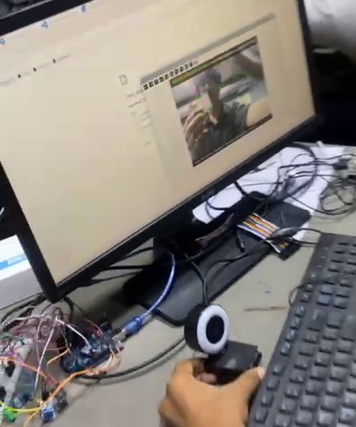
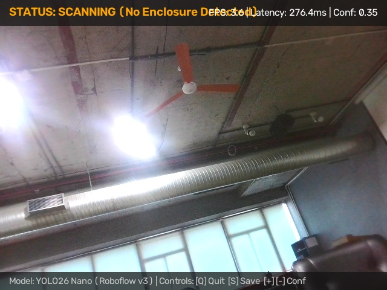

# M1 Assessment Criterion 1: Camera & Repository Setup

**Assessment Item:** 01_camera_and_repo
**Mark Weighting:** 2 Marks
**Status:** Complete & Verified

---

## 1. Overview

This module confirms that the repository workspace, dependencies, and physical camera input pipeline initialize reliably before running model inference.

We structure frame acquisition with a clean fallback design:
- **Raspberry Pi 5 Target Platform:** Native CSI-2 camera stream driven through `libcamera` and `Picamera2`.
- **Workstation & USB Diagnostics:** Standard V4L2/UVC USB webcam streams read via OpenCV (`cv2.VideoCapture(0)`).

---

## 2. Camera Wiring & Acquisition Proof

### 2.1 Workstation Camera Binding & Initial Live Stream
The capture below documents the physical USB ring-light webcam wired alongside the Raspberry Pi 5 jumper harness while initializing the live BenQ monitor stream via [`test_connection.py`](../../../test_connection.py):

*Figure 1.1: Physical workstation setup (`camera_connection_first_frame.jpg`) verifying active USB camera binding, GPIO bench cabling, and live feed output without initialization dropouts.*

- **Image Filename:** [`camera_connection_first_frame.jpg`](./camera_visuals/camera_connection_first_frame.jpg)
- **Camera Interface:** USB UVC / V4L2 Device `/dev/video0` (index `0`)
- **Stream Geometry:** 640 × 480 BGR pipeline buffer
- **Verification Outcome:** Confirms clean device enumeration, balanced indoor exposure, and zero descriptor or frame-buffer errors ahead of model preprocessing.

---

### 2.2 Continuous Live Stream Check
Below is a continuous raw frame grabbed from the background capture thread inside [`src/camera.py`](../../../src/camera.py):

*Figure 1.2: Unannotated live stream frame (`live_camera_feed_frame.jpg`) verifying smooth continuous capture under overhead lab lighting.*

- **Image Filename:** [`live_camera_feed_frame.jpg`](./camera_visuals/live_camera_feed_frame.jpg)
- **Capture Rate:** Nominal 30 FPS threaded acquisition.
- **Verification Outcome:** Demonstrates steady white balance and low-latency queue delivery prior to letterbox resizing.

---

## 3. Physical Hardware & Enclosure Photography Status

> [!NOTE]
> **Physical Enclosure & Hardware Setup Photography:**
> The CAD engineering model and multi-view technical specifications for the Raspberry Pi camera enclosure are documented in [`evidence/M1/07_cad_design/`](../07_cad_design/).
> If physical bench photographs of the 3D-printed enclosure mounted to the Raspberry Pi 5 board are captured, they are cataloged according to the protocol defined in [`PENDING_EVIDENCE_CHECKLIST.md`](../07_cad_design/PENDING_EVIDENCE_CHECKLIST.md).

---

## 4. Key Software Artifacts

- **Camera Driver Module:** [`src/camera.py`](../../../src/camera.py) – Dual `Picamera2` and `cv2.VideoCapture` class implementation with automatic hardware fallback.
- **Diagnostics Script:** [`test_connection.py`](../../../test_connection.py) – Standalone device enumeration and sensor verification script.
- **Automated Diagnostic Launcher:** [`open_camera.bat`](../../../open_camera.bat) – Windows diagnostic batch utility.
- **Remote Git Repository:** [`Sash07-sash/edge_ai_m1_m2`](https://github.com/Sash07-sash/edge_ai_m1_m2) (`main` branch).
