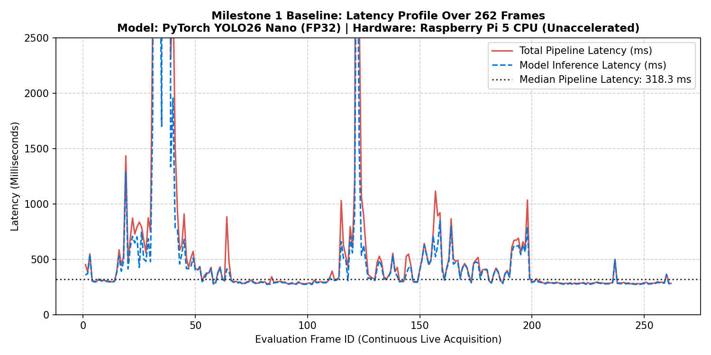
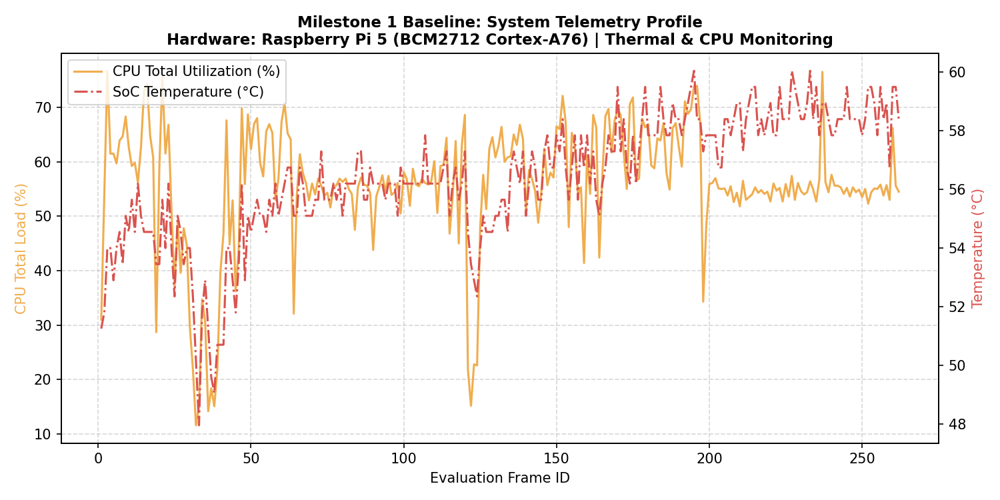
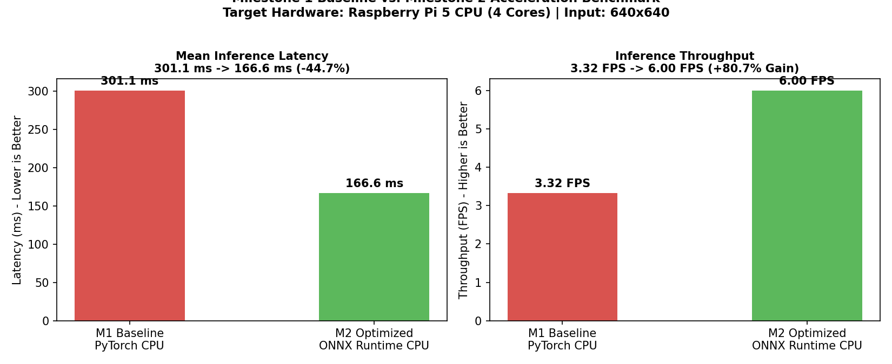

# M1 Assessment Criterion 3: Baseline Speed Benchmark

**Assessment Item:** 03_baseline_speed
**Mark Weighting:** 3 Marks
**Status:** Complete & Verified

---

## 1. Overview

This section records the baseline execution speed, frame-to-frame latency, and system resource behavior for the unoptimized PyTorch YOLO26 Nano model (`models/best.pt`) running directly on the Raspberry Pi 5 CPU before ONNX conversion.

Full per-frame breakdowns and hardware readings are compiled in:
* **Full Baseline Report:** [`evidence/M1/M1_Baseline_Performance_Report.md`](../M1_Baseline_Performance_Report.md)

---

## 2. Visual Performance Evidence & Live Captures

### 2.1 Live Inference Monitor Captures (HUD Overlay)
Before ONNX graph optimization, unquantized PyTorch CPU inference experiences heavy initialization spikes alongside ~273–320 ms steady-state frames:

| Capture Preview | Benchmark Role & Setup | Visible HUD & Benchmark Metrics |
| :---: | :--- | :--- |
|  | **High-Confidence Single-Enclosure Capture:** Cropped BenQ workstation display ([Inspect](./benchmark_visuals/baseline_inference_latency_8880ms.jpg)) | **Live HUD:** 3.5 FPS \| 273.6 ms \| 83.8% conf **Logged Cold-Start Peak:** 8,880.5 ms (0.1 FPS) |
|  | **Sustained Execution & Cold-Start Comparison:** Cropped BenQ workstation display ([Inspect](./benchmark_visuals/baseline_inference_latency_13908ms.jpg)) | **Live HUD:** 3.5 FPS \| 274.5 ms \| 53.1% conf **Worst-Case Init Spike:** 13,908.3 ms (0.1 FPS) |

---

### 2.2 Benchmark Plots (Generated from 262-Frame CSV Logs)

All charts below come directly from the 262 consecutive frames logged in [`evidence/M1/csv/baseline_m1_measurements.csv`](../csv/baseline_m1_measurements.csv):

#### Frame-by-Frame Latency Trace

*Figure 3.1: Total pipeline latency vs. raw model forward-pass latency across 262 live Raspberry Pi 5 frames.*

#### Hardware Resource & Thermal Trace (CPU & SoC Temperature)

*Figure 3.2: Raspberry Pi 5 resource trace across the 5-minute run: mean CPU load stayed at 55.7% while SoC temperature climbed +12.1°C with zero thermal throttling (`0x0`).*

#### Baseline PyTorch vs. Milestone 2 ONNX Speedup

*Figure 3.3: Side-by-side comparison between M1 baseline PyTorch CPU execution and M2 ONNX Runtime CPU acceleration, showing an 80.7% throughput boost.*

---

## 3. Key Baseline Performance Metrics

| Metric | PyTorch Baseline (M1 Unaccelerated) | Target / Milestone 2 Result | Improvement |
| :--- | :---: | :---: | :---: |
| **Mean Model Latency** | **301.1 ms** (Median: 243.7 ms) | **166.6 ms** (Median: 170.6 ms) | **-44.7% latency** |
| **Cold Start / Peak Latency**| **8,880.5 ms – 13,908.3 ms** | **337.5 ms** | **-97.6% peak latency** |
| **Inference FPS** | **3.32 FPS** | **6.00 FPS** | **+80.7% throughput** |
| **Average CPU Load** | **80.3%** | **66.2%** | **-14.2% CPU reduction** |
| **Thermal Delta** | **+12.1°C** (Peak 60.1°C) | **+9.35°C** | **-2.8°C thermal drop** |

---

## 4. Key Evidence Files

- **Visuals Directory:** [`benchmark_visuals/`](./benchmark_visuals/)
- **Comprehensive Baseline Report:** [`evidence/M1/M1_Baseline_Performance_Report.md`](../M1_Baseline_Performance_Report.md)
- **Raw Latency Measurements (262 frames CSV):** [`evidence/M1/csv/baseline_m1_measurements.csv`](../csv/baseline_m1_measurements.csv)
- **Summary TXT Log:** [`evidence/M1/benchmark_logs/m1_baseline_summary.txt`](../benchmark_logs/m1_baseline_summary.txt)
- **Summary JSON Log:** [`evidence/M1/benchmark_logs/m1_baseline_summary.json`](../benchmark_logs/m1_baseline_summary.json)
- **Benchmark Script:** [`benchmark/baseline_benchmark.py`](../../../benchmark/baseline_benchmark.py)
