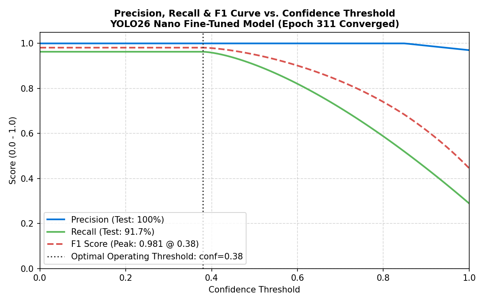
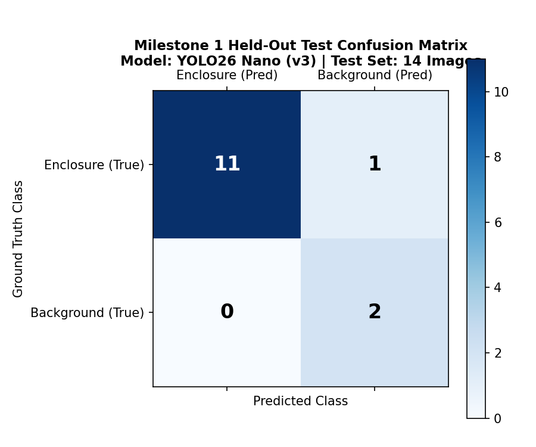
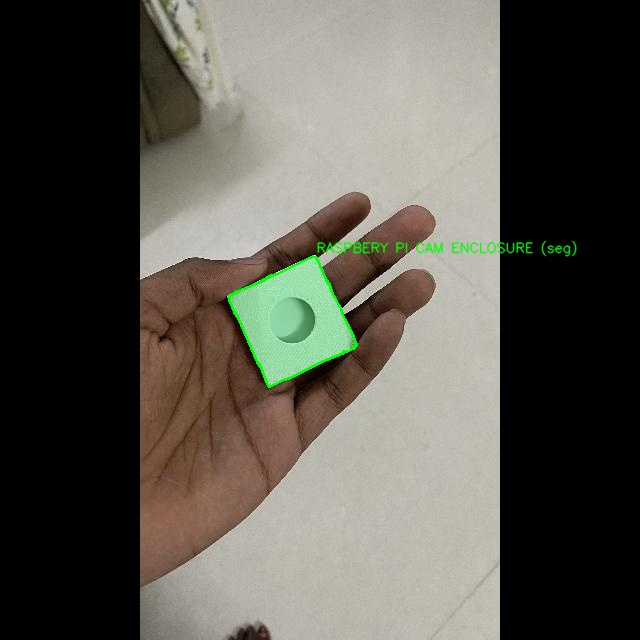
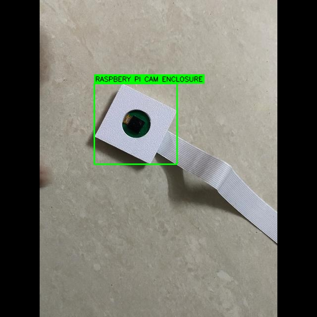
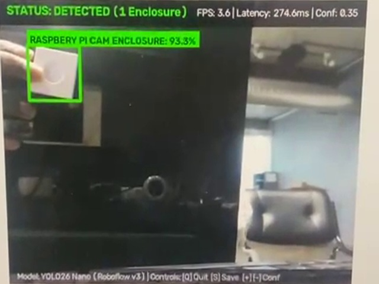
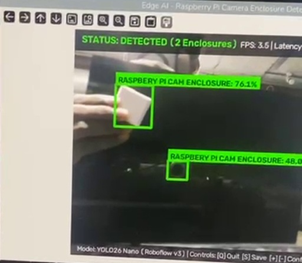
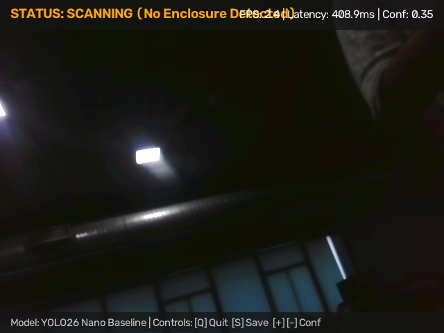
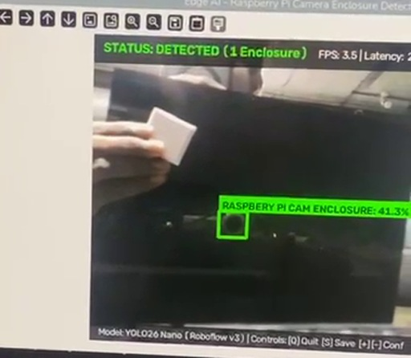
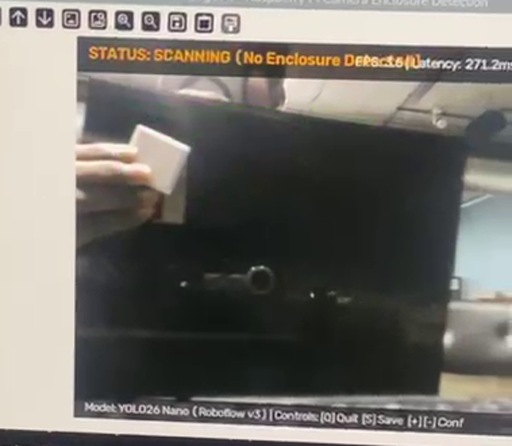

# M1 Assessment Criterion 6: Train & Run Baseline Detector

**Assessment Item:** 06_train_and_run_detector
**Mark Weighting:** 5 Marks
**Status:** Complete & Verified

---

## 1. Overview

Here we summarize training convergence for our baseline **YOLO26 Nano** detector alongside real-time camera test runs and documented failure modes on Raspberry Pi 5 edge hardware.

Full metric tables, held-out offline samples, and error breakdowns are in:
* **Full Training & Detection Report:** [`M1_Training_and_Detection_Report.md`](./M1_Training_and_Detection_Report.md)

---

## 2. Visual Evidence Gallery

### A. Convergence Curves & Held-Out Confusion Matrix
| Precision-Recall & F1 Operating Curve | Test Split Confusion Matrix |
| :---: | :---: |
|  |  |
| [Inspect PR Curve](./visual_evidence/m1_precision_recall_f1_curve.png) | [Inspect Confusion Matrix](./visual_evidence/m1_test_confusion_matrix.png) |

---

### B. Held-Out Test Split Predictions
| Test Sample 01 (`IMG_1032`) | Test Sample 02 (`IMG_1104`) |
| :---: | :---: |
|  |  |
| Precision: 100% \| Recall: 91.7% \| mAP@50: 99.31% | Single clean enclosure prediction without overlapping boxes |

---

### C. Live OpenCV Camera Detections
| Live Single Enclosure Detection | Dual-Box / Confusion Stress Frame |
| :---: | :---: |
|  |  |
| 93.3% Confidence \| Latency: 274.6 ms \| FPS: 3.6 | 2 Enclosures (`76.1%` handheld + `43.0%` secondary lens region) \| FPS: 3.5 |

---

### D. Documented Baseline Failure Cases (Error Analysis)
| Scenario 2: 90° Side Profile Miss | Scenario 8: Complex Background Confusion | Scenario 4: Handheld Miss (`SCANNING`) |
| :---: | :---: | :---: |
|  |  |  |
| Missed detection on edge-on housing profile | Handheld enclosure missed while lens triggers `41.3%` false alarm | Enclosure held off-center misses threshold (`STATUS: SCANNING`) |

---

## 3. Key Evidence Files

- **Comprehensive Report:** [`M1_Training_and_Detection_Report.md`](./M1_Training_and_Detection_Report.md)
- **Visual Evidence Directory:** [`visual_evidence/`](./visual_evidence/)
- **Accuracy Metrics (CSV):** [`evidence/M1/accuracy_results/m1_test_accuracy_metrics.csv`](../accuracy_results/m1_test_accuracy_metrics.csv)
- **Accuracy Metrics (JSON):** [`evidence/M1/accuracy_results/m1_test_accuracy_metrics.json`](../accuracy_results/m1_test_accuracy_metrics.json)
- **Visual Detection Test Suite (23 Images):** [`evidence/M1/detection_tests/`](../detection_tests/)
- **Live Video Screenshots (19 Frames):** [`evidence/M1/screenshots/`](../screenshots/)
- **Model Checkpoints:** [`models/best.pt`](../../../models/best.pt) (5.17 MB PyTorch weights).
